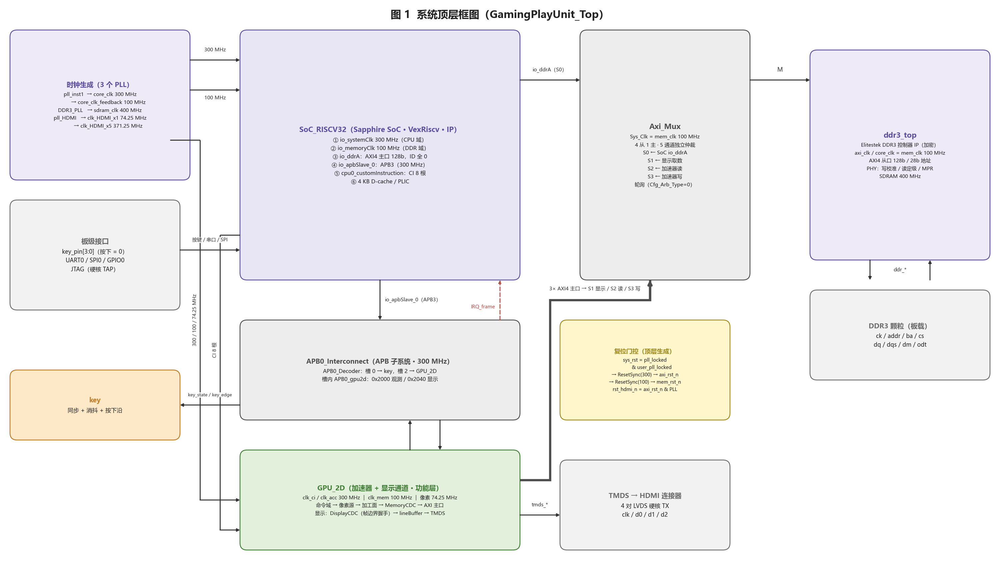
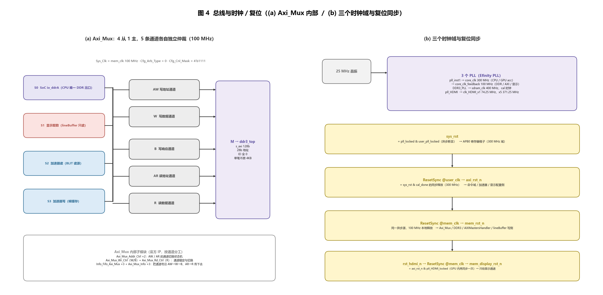
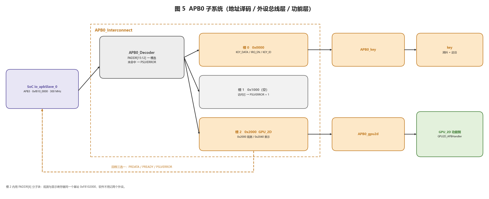
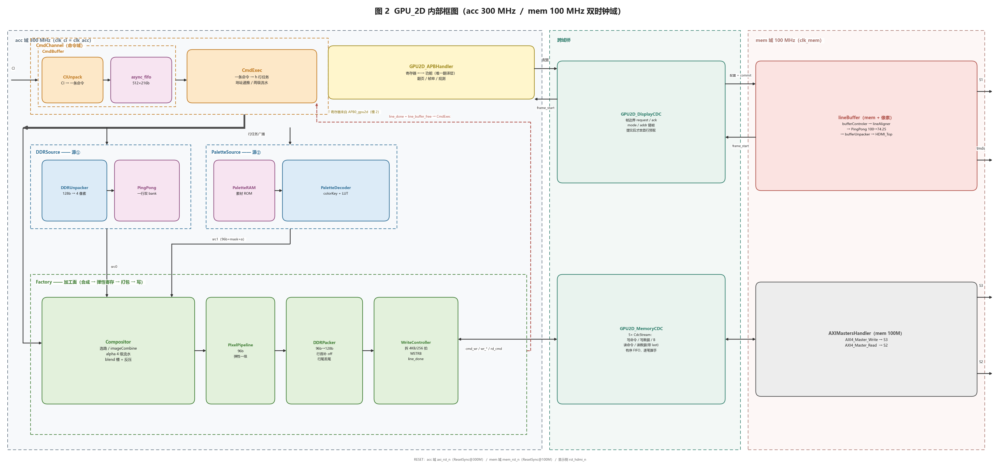
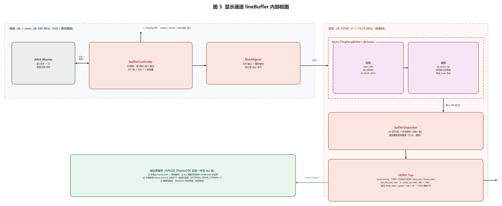

# 架构 · 系统整体框图与模块关系

> **这份文档回答一个问题**：当前 `RTL/` 里这些模块是怎么拼起来的、谁连谁、为什么这么连。
>
> - **依据**：`RTL/` 当前代码 + `project/GamingPlayUnit/GamingPlayUnit.xml` 的编译文件表（63 个设计文件 = 61 个 `.v` + 2 个 `.vh`，另加 1 个 SDC）。
> - **只写现状**：图里出现的每个方框都是已经综合过的模块；没有实装的东西不画。
> - **图是生成的**：`docs/spec/img/gen_block_diagrams.py`（matplotlib），改 RTL 拓扑后重跑一次即可。
> - **配套**：模块内部行为看 `硬件_加速器.md` / `硬件_显示通路.md`，纪律看 `硬件_RTL规范.md`。
> - **2026-10-30 改版**：主频拆成 **300 MHz（CPU/GPU）** 与 **100 MHz（DDR/AXI/显示）** 两个 fabric 时钟，
>   新增 `GPU2D_MemoryCDC` / `GPU2D_DisplayCDC` / `PixelPipeline` / `CdcStream` / `ResetSync` 与 SDC 约束。

---

## 目录

| 节 | 内容 |
|---|---|
| §1 | 五层结构 |
| §2 | 系统顶层（图 1）—— 引脚、连线 |
| §3 | 三个时钟域与复位同步（图 4b） |
| §4 | 总线子系统（图 4a + 图 5） |
| §5 | GPU_2D 内部（图 2）—— 双域、三座跨域桥、三个闭环 |
| §6 | 显示通道 lineBuffer（图 3）—— 帧提交握手 |
| §7 | 一帧的完整接力 |
| §8 | 模块层次树 |
| §9 | 模块清单（文件 / 实例 / 上下级） |
| §10 | 关系汇总 |
| §11 | 读图易错点 |

---

## 1. 五层结构

| 层 | 内容 | 对应 RTL |
|---|---|---|
| **L1 软件** | 游戏逻辑、命令生成、双缓冲交帧、脏区 | `code/`、`project/.../embedded_sw/` |
| **L2 总线** | APB3（控制面，300 MHz）+ AXI4（数据面，100 MHz）+ `Axi_Mux` 四路汇聚 | `Axi_Mux`、`APB0_Interconnect` |
| **L3 加速** | GPU_2D：命令域 / 像素源 / 加工面 / AXI 主口，**300 MHz 计算 + 100 MHz 访存** | `Peripherial/GPU_2D/**` |
| **L4 存储** | 片上 BRAM（素材/调色板/命令 FIFO/行缓冲）→ DDR3（100 MHz）→ SPI Flash | `PaletteRAM`、`BlockRAM`、`ddr3_top` |
| **L5 显示** | lineBuffer：DDR 取数（100 MHz）→ 跨域双 bank → 拆包 → TMDS（74.25 MHz） | `lineBuffer/**` |

---

## 2. 系统顶层（图 1）



### 2.1 顶层只有四类东西

| 类别 | 模块 | 说明 |
|---|---|---|
| **买来的 IP** | `SoC_RISCV32`（Sapphire SoC + VexRiscv）、`ddr3_top`（Elitestek DDR3 控制器，**源码加密**）、`Axi_Mux` | 只接端口，不进去改 |
| **自建总线** | `APB0_Interconnect`（APB 译码 + 外设总线层） | 见 图 5 |
| **自建外设（功能层）** | `GPU_2D`（加速器 + 显示通道）、`key`（消抖） | 见 图 2 / 图 3 |
| **顶层胶水** | 时钟/复位门控（`ResetSync` ×2）、CI/APB/AXI/TMDS 的连线 | `GamingPlayUnit_Top.v` 只有 `wire` + `assign` + 例化 |

### 2.2 引脚分组（顶层端口）

| 组 | 端口 | 去向 |
|---|---|---|
| 时钟 | `axi_clk` / `core_clk`（300 MHz）/ `core_clk_feedback`（100 MHz）/ `sdram_clk` / `rx_cal_clk` / `tx_cal_clk` / `tx_cal_clk_90edge` / `clk_HDMI_x1` | 3 个 PLL 的输出 |
| PLL 状态 | `pll_locked` / `user_pll_locked` / `pll_HDMI_locked` / `pll_shift[2:0]` / `pll_shift_sel[4:0]` / `pll_shift_ena` | DDR3 动态相位校准 |
| DDR3 | `ddr_ck_hi/lo`、`ddr_addr`、`ddr_ba`、`ddr_cs_n`、`ddr_ras_n/cas_n/we_n`、`ddr_dq_*`、`ddr_dqs_*`、`ddr_dm_*`、`ddr_odt` | DDR3 颗粒 |
| HDMI | `tmds_blue_o[9:0]` / `tmds_green_o` / `tmds_red_o` / `tmds_clk_o` + 4 组 `TX_OE` / `TX_RST` | LVDS 硬核 → HDMI 连接器 |
| 板级 | `key_pin[3:0]`、`system_uart_0_*`、`system_spi_0_*`、`soc_gpio_*` | 按键 / 串口 / SPI / GPIO |
| 调试 | `jtag_inst1_*`（硬核 TAP，可切 `SOFT_JTAG`） | OpenOCD |

### 2.3 顶层连线（逐条）

| # | 源 → 目标 | 信号 | 备注 |
|---|---|---|---|
| 1 | `SoC_RISCV32.io_ddrA` → `Axi_Mux` **S0** | AXI4 128b | CPU 唯一的 DDR 出口，ID 恒 0 |
| 2 | `Axi_Mux` **M** → `ddr3_top.s_axi` | AXI4 128b / 28b 地址 | 32→28 位截断（全系统 < 256 MB） |
| 3 | `SoC_RISCV32.io_apbSlave_0` → `APB0_Interconnect` | APB3 @300 MHz | 窗口 `0xf810_0000` |
| 4 | `APB0_Interconnect` ↔ `GPU_2D`（功能侧） | 寄存器值 / 事件 / 观测 | **APB 口不经过顶层**，顶层只走"翻译好"的那组线 |
| 5 | `APB0_Interconnect` → `key`（功能侧） | `key_state` / `key_edge` | 总线层 `APB0_key` 在互连里 |
| 6 | `SoC_RISCV32.cpu0_customInstruction_*` → `GPU_2D` | CI 8 根 | 命令面，不占地址空间 |
| 7 | `GPU_2D.m_AXI_AW/W/B` → `Axi_Mux` **S3** | AXI4 写 @100 MHz | 加速器写帧缓存 |
| 8 | `GPU_2D.m_AXI_AR/R` → `Axi_Mux` **S2** | AXI4 读 @100 MHz | BLIT / 块拷贝读源 |
| 9 | `GPU_2D.lineBuffer_m_AXI_*` → `Axi_Mux` **S1** | AXI4 读 @100 MHz | 显示取数，每行 240 拍 |
| 10 | `GPU_2D.tmds_*` → 引脚 | TMDS 4 对 | 硬核 LVDS TX |
| 11 | `APB0_Interconnect.IRQ_frame` → `SoC.userInterruptA` | 电平中断 | PLIC 中断号 16 |

**时钟怎么进顶层**（与旧版的差别）：

| 顶层信号 | 来源 | 频率 | 谁用 |
|---|---|---|---|
| `user_clk` | `core_clk`（`ASYN_AXI_CLK = 0`） | **300 MHz** | SoC 系统域、APB0、`GPU_2D.clk_ci/clk_acc` |
| `mem_clk` | `core_clk_feedback` | **100 MHz** | SoC `io_memoryClk`、`Axi_Mux`、`ddr3_top`、`GPU_2D.clk_mem` |
| `clk_HDMI_x1` | `pll_HDMI` | **74.25 MHz** | 像素域 |

> ★ `mem_clk` 用 PLL 的 `core_clk_feedback` 而不是 `DDR3_PLL` 的 `clk_100m`：后者在 Ti60 上只能走
> **RCLK（外设专用）**，进不了 fabric 布线。`core_clk_feedback` 是 TL0 的 GCLK 输出，100 MHz、
> 与 300 MHz 同源，DDR 的 CK 比例也不受影响。

---

## 3. 三个时钟域与复位同步（图 4b）



### 3.1 时钟树

| 时钟 | 频率 | 来源 | 谁用 |
|---|---|---|---|
| `core_clk` → `user_clk` | **300 MHz** | `pll_inst1`（div 4） | SoC 系统域（CPU）、APB0、命令域、加速器计算 |
| `core_clk_feedback` → `mem_clk` | **100 MHz** | `pll_inst1`（div 12） | SoC 存储器域、`Axi_Mux`、`ddr3_top`、GPU `clk_mem`、lineBuffer 写侧 |
| `clk_HDMI_x1` | **74.25 MHz 标称**（PLL 实测 13.483 ns ≈ **74.17 MHz**，59.94 Hz） | `pll_HDMI`（div 30） | PingPong 读侧、`bufferUnpacker`、`HDMI_Top` |
| `clk_HDMI_x5` | 371.25 MHz | `pll_HDMI`（div 6） | 只给 LVDS 硬核并串 |
| `sdram_clk` / `rx_cal_clk` / `tx_cal_clk` / `tx_cal_clk_90edge` | 400 MHz | `DDR3_PLL` | `ddr3_top` 内部 |

`RTL/constraints/GamingPlayUnit.sdc` 把这两组时钟按"相关但有界"约束：`core_clk` 与
`core_clk_feedback` 之间用 `set_max_delay 3.333`（= 1/300 MHz）锁住跨域路径的延迟上限，
JTAG 单独成异步组，HDMI 与 core 之间也给了 max_delay + hold 豁免。

### 3.2 复位：一个异步源，各自时钟域本地同步释放

| 复位 | 生成 | 吃它的人 |
|---|---|---|
| `sys_rst` | `pll_locked & user_pll_locked`（异步断言） | `APB0_Interconnect`（寄存器格子）、`key` |
| `axi_rst_n` | `ResetSync @user_clk(sys_rst & cal_done)` | `rst_ci_n` / `rst_acc_n`：命令域、加速器、`GPU2D_APBHandler` |
| `mem_rst_n` | `ResetSync @mem_clk(sys_rst & cal_done)` | `Axi_Mux`、`ddr3_top`、`AXIMastersHandler`、lineBuffer 写侧 |
| `rst_hdmi_n` | `axi_rst_n & pll_HDMI_locked` | **只给显示通道**（GPU 内再经 `ResetSync @mem_clk` → `mem_display_rst_n`） |

`ResetSync`（`RTL/common/ResetSync.v`）就是"异步断言 + 目标域两级触发器同步释放"，
SDC 里那两条 3.333 ns 的 max_delay 正是给这种"异步源 + 本地释放"的组合兜底。

为什么不能合并：寄存器格子必须早于 `axi_rst_n` 放行（CPU 要在 DDR 校准完成前写基址）；
`rst_hdmi_n` 必须晚于 `axi_rst_n`（像素域不能用未校准的 DDR）；两个 fabric 域各自释放，
才能保证 100 MHz 侧的 DDR/AXI 先于 300 MHz 侧的控制逻辑稳定。

### 3.3 跨时钟域点（四处 + 一处 SoC 内部）

| 跨域点 | 方向 | 做法 |
|---|---|---|
| 命令 FIFO（`CmdBuffer.async_fifo`） | `clk_ci` → `clk_acc` | 格雷码指针异步 FIFO（今天两个时钟同为 300 MHz，结构仍按异步做） |
| **`GPU2D_MemoryCDC`** | acc 300 → mem 100 / 回程 | 5 条 `CdcStream`（写命令 / 写数据 / B / 读命令 / 读数据带 last），每条都是"异步 FIFO + 一级预读"的 ready/valid |
| **`GPU2D_DisplayCDC`** | mem 100 ↔ acc 300 | 帧边界 **request / ack 四相握手**：mem 侧出 `frame_start` 请求，acc 侧翻页后锁存 `mode/addr` 并应答，mem 侧收到 `commit` 才放首行预取 |
| 行缓冲（`async_PingPongBuffer`） | mem 100 → 像素 74.25 | 两个 `async_fifo` + `BlockRAM` 双 bank，**换块决策只在读侧** |
| （SoC 内部）system ↔ memory | 300 ↔ 100 | Sapphire SoC 自带的桥，本工程只接两个时钟 |

> ★ 像素域 → mem 域这一跳**仍然**是 lineBuffer 内部的 "toggle + 2FF + 边沿比较"（74.25 → 100 MHz 太慢，不能直接过 2FF）；
> mem 域 → acc 域这一跳换成了 request/ack，并把"这一帧该用哪组基址/模式"作为 payload 一起搬，翻页与取数严格同帧。

---

## 4. 总线子系统（图 4a + 图 5）

### 4.1 AXI4 数据面：4 个主，5 条通道（100 MHz）

`Axi_Mux` 是官方多主汇聚 IP（`define X4` ⇒ `Axi_Chnanel_Num = 4`），
**AW / W / B / AR / R 五条通道各自独立仲裁**，所以读与写可以同时在飞。

| 从口 | 谁 | 读/写 | 备注 |
|---|---|---|---|
| **S0** | `SoC_RISCV32.io_ddrA` | 读写 | CPU 取指/数据/素材装载 |
| **S1** | `lineBuffer`（显示取数） | **只读** | 每行 240 拍，60 帧 ≈ 166 MB/s |
| **S2** | `GPU_2D` 读通道 | 读 | BLIT / 块拷贝读源 |
| **S3** | `GPU_2D` 写通道 | 写 | 帧缓存写入 |

四条硬约束：ID 全链路为 0；地址 < `0x1000_0000`（28 位）；单笔不跨 4 KB、≤256 拍；
`Cfg_Cnl_Mask` 必须 `4'b1111`。

### 4.2 APB3 控制面：一个窗口，三个槽（300 MHz）



| 槽 | 地址 | 总线层 | 功能层 |
|---|---|---|---|
| 0 | `0xf8100000` | `APB0_key` | `key` |
| 1 | `0xf8101000` | **空**（返回 `PSLVERROR=1`） | — |
| 2 | `0xf8102000` | `APB0_gpu2d` | `GPU_2D` |
| 3~15 | `0xf8103000`~ | 扩展预留 | — |

槽 2 内部再用 `PADDR[6]` 分成 **`0x2000` 观测（只读）/ `0x2040` 显示 + 中断** 两个子块，软件只记一个基址。

> ★ **总线层在 `APB0_Interconnect` 里，功能层在顶层** —— 所以 `GPU_2D` 没有 APB 从口，
> 只有 `enable / split_pending / framea_base_addr / ...` 这组功能侧端口。

---

## 5. GPU_2D 内部（图 2）



### 5.1 两个 fabric 域

| 域 | 时钟 | 模块 |
|---|---|---|
| **acc 域** | `clk_ci` = `clk_acc` = 300 MHz | `CmdChannel`（`CmdBuffer` / `CmdExec`）、`DDRSource`、`PaletteSource`、`Factory`（`Compositor` / `PixelPipeline` / `DDRPacker` / `WriteController`）、`GPU2D_APBHandler` |
| **mem 域** | `clk_mem` = 100 MHz | `AXIMastersHandler`、`lineBuffer` 写侧 |
| 像素域 | `clk_HDMI_x1` = 74.25 MHz | `bufferUnpacker`、`HDMI_Top`、PingPong 读侧 |

`ASYNC_MEMORY = 1` 时由 generate 例化**两座桥**（MemoryCDC / DisplayCDC）；第三座 `async_PingPongBuffer` 在 lineBuffer 里，任何时候都在。置 0 时两座桥旁路成直连（给独立 TB 用同频仿真）。
`memory_clk / memory_rst_n` 就是"mem 域"的时钟复位，桥的两侧各用各的。

### 5.2 命令域：`CmdChannel` = `CmdBuffer` + `CmdExec`

| 模块 | 干什么 | 关键点 |
|---|---|---|
| `CmdBuffer` | CI 应答握手 + 命令队列 | 收一条 CI 就欠一个响应，CPU 是**阻塞握手** |
| ├ `CIUnpack` | 多条 CI → 一条命令 | 第 1 条给"多大/画到哪"，其后每条给一张图的源与模式 |
| └ `async_fifo` | 命令队列 | 512 深 × 216 位，内含 `BlockRAM`；跨 `clk_ci → clk_acc` |
| `CmdExec` | 一条命令 → h 个行任务 | 地址递推/镜像；**S_MULT / S_ADDR 两级流水**把"高 × 跨距"的乘法从取命令路径上挪走（300 MHz 时序） |

命令在 FIFO 里是"几根线首尾接起来存"，对外仍是分开的几根线：类型 / 目的 / 宽 / 高 + 每图一格的源地址 / 参数 / 模式。

### 5.3 行任务广播

`CmdExec` 每发一行，把同一组线**广播**给三个下游（不接力、不排队）：

| 字段 | 含义 | 谁看 |
|---|---|---|
| `line_start` | 单拍：这一行的任务在这拍有效 | 全部 |
| `line_dst_addr` / `line_w` | 本行目的起始地址 / 像素宽 | 全部 |
| `line_src_addr[n]` / `line_param[n]` / `line_flags[n]` | 第 n 张图的源地址 / 参数 / 模式位 | 两路源 + 合成器 |
| `line_fx_en` | 本命令有没有第二张图（合成） | `PaletteSource` / `Compositor` |
| `line_*_last` | "最后一格"（合成时 = 第二张图） | `DDRSource`（背景）/ `Compositor` / 写侧 |

`line_flags[2:0]` 合成模式、`[3]` PRAM 源、`[4]` ck、`[5]` MX、`[6]` MY、`[7]` ROT90（搭在 `param[23]` 上）。

### 5.4 两路像素源

| 源 | 链路 | 出口 |
|---|---|---|
| **源①** `DDRSource` | `AXI 读 → DDRUnpacker（128b→4×RGB888，丢 src_off）→ async_PingPongBuffer（一行双 bank）` | `src0_*`：96 位/拍（4 个 RGB888） |
| **源②** `PaletteSource` | `PaletteRAM（PRAM 索引）→ PaletteDecoder（colorKey + PaletteLUT 4 份查表）`；镜像 / ROT90 在源里按 `flags` 判 | `src1_*`：96 位 + 12 位字节掩码 + 32 位 α |

- **格式归源自己管**；**bank 长在源里**；**ck 判在源里**（按像素比键色 `0x2078`，命中清掩码）。
- `PaletteSource` 的旋转路新增 `R_MUL / R_ADDR` 两个准备态，把"几何偏移乘法"和"列起点加法"拆到寄存器两侧 ⇒ 300 MHz 下不再是一条长组合路径。

### 5.5 加工面：`Factory` = 合成 → 弹性寄存 → 打包 → 写

| 级 | 模块 | 输入 → 输出 | 关键点 |
|---|---|---|---|
| ① | `Compositor` | 多路 96b → 一路 96b + 掩码 | 选路；含 `imageCombine`（图一+图二）与 `alphaBlending`（**4 级弹性流水**，带 `pipeline_free`）；FILL 纯色也在这里造 |
| ② | **`PixelPipeline`** | 96b → 96b | **新增**：合成器与打包器之间的一级弹性寄存器；`line_start/line_done` 时丢弃尾巴，`stage_free` 参与反压 |
| ③ | `DDRPacker` | 96b → 128b | 16 字节 ≠ 3 字节×4 ⇒ 跨拍拼接；行首补 `dst_off` 哑字节、行尾丢多读尾巴 |
| ④ | `WriteController` | 128b → AXI 写 | 宽×3 算字节、拆 4KB/256 拍、`WSTRB = head & tail & packer_mask`、**唯一能报 `line_done`** |

`Factory` 是 **`line_buffer_free` 的唯一汇总点**，现在是三项相与：

```
line_buffer_free = 各源 free & 写侧 wr_free & stage_free(PixelPipeline 空)
```

### 5.6 访存侧：`GPU2D_MemoryCDC` + `AXIMastersHandler`

`GPU2D_MemoryCDC` 把 acc 侧的 `cmd_wr_* / wr_* / rd_cmd_*` 原语搬到 mem 侧，**5 条独立有序 FIFO**
（写命令、写数据、写响应、读命令、读数据；读数据把 `last` 与数据一起搬）。
`AXIMastersHandler` 仍是两个 `AXI4_Master`（写 + 读），约束不变：单 outstanding、ID 恒 0、单笔不跨 4 KB。

> ★ 拆成两个域的理由：计算（合成/混合/色调）要跑 300 MHz 才能在一行时间内算完；
> 而 DDR/AXI 侧维持 100 MHz 保持与 DDR3 控制器、`Axi_Mux` 的比例。桥只搬"每笔事务"，
> 不搬像素流，所以 FIFO 很浅（`ADDR_WIDTH`=2/3 ⇒ 4~8 深），不占 BRAM。

### 5.7 寄存器层与显示配置：`GPU2D_APBHandler` + `GPU2D_DisplayCDC`

| 方向 | 内容 |
|---|---|
| 寄存器 → 功能 | 显示侧：`enable` / `mode` / `{段0,段1} 基址`；加速器侧：行模式另走 `lineBuffer_mode_r` |
| 功能 → 寄存器 | `done_clr`、`fps_acc_val` / `fps_cpu_val`、`busy` / `cmd_done` / `frame_done` / 读写拍数 |

显示配置要跨到 mem 域才能给 lineBuffer 用，因此**配置和帧边界一起过 `GPU2D_DisplayCDC`**：

```
acc 域（Handler）--enable/mode/addr--> DisplayCDC --mem_enable/mode/addr--> mem 域（lineBuffer）
mem 域（lineBuffer）--frame_start--> DisplayCDC --acc_frame_start--> acc 域（Handler 翻页/计帧率）
DisplayCDC --mem_frame_commit--> lineBuffer（放行下一帧首行预取）
```

### 5.8 三个闭环（这张图真正的重点）

| 闭环 | 信号 | 路径 |
|---|---|---|
| **① 节奏** | `line_buffer_free` = 各源 free & 写侧 `wr_free` & `stage_free` | `Factory` → `CmdExec` |
| **② 完成** | `line_done`（"这一行连 B 响应都回来了"） | `WriteController` → `Factory` → `CmdExec` |
| **③ 帧同步** | `frame_start` → 翻页 → `commit` | `lineBuffer` → `DisplayCDC` → `Handler` / `lineBuffer_mode_r` |

少了 `stage_free`，合成器会在打包器/写侧还忙时被"源空"骗着接下一行，尾巴被 `line_start` 清掉（旧版实测整段偏移 4 字节）。
少了 `line_done`，命令会在数据还在路上时收工；少了 `commit`，新一帧会在旧帧数据还没取完时开扫。

---

## 6. 显示通道 `lineBuffer`（图 3）



### 6.1 链路（六级，写域 100 MHz → 像素域 74.25 MHz）

| 级 | 模块 | 干什么 | 时钟 |
|---|---|---|---|
| 0 | `AXI4_Master` | 对 DDR 发读命令（单笔不跨 4KB） | 100 MHz |
| 1 | `bufferControler` | 行预取：按 `{段0, 段1}` 起址；全屏 241 拍、分屏 2×120 拍；拆笔 | 100 MHz |
| 2 | `lineAligner` | 行首非 16B 对齐时丢 `skip` 字节（241 → 240 拍） | 100 MHz |
| 3 | `async_PingPongBuffer` | 双 bank 跨 100 MHz ↔ 74.25 MHz；**块切换只在读侧** | 跨域 |
| 4 | `bufferUnpacker` | 16 字节/拍 → RGB888（5,5,6… 循环） | 74.25 MHz |
| 5 | `HDMI_Top` | `pixel_timing`（720p60 + `data_req` + `frame_start`）+ `dvi_encoder_Top` | 74.25 MHz |

### 6.2 帧提交：`EXTERNAL_FRAME_COMMIT`

`lineBuffer` 新增参数 `EXTERNAL_FRAME_COMMIT` 与端口 `lineBuffer_frame_commit`：

- `= 1`（系统）：`bufferControler` 的"帧边界"用 **`frame_commit`**（来自 `DisplayCDC`），而不是内部跨过来的 `frame_start`；
- `= 0`（独立 TB）：退回旧行为，用自己的 `frame_start`。

这样"翻页 → 锁存新基址/模式 → 通知取数侧可以开扫"是**一次完整握手**，不再依赖"2FF 采样恰好没漏"。

### 6.3 三个数量必须分开记

| 项 | 值 | 谁用 |
|---|---|---|
| 可见宽度 | 1280 像素 | `pixel_timing` |
| 每行**读多少字节** | 3840（= 240 拍） | `bufferControler` / `bufferUnpacker` |
| 每行**下一行跳多远** | 5760 字节 | 取数地址递推 |

---

## 7. 一帧的完整接力

```
 ① CPU 写 APB 槽 2（基址 / ENABLE / SPLIT）
 ② CPU 发 CI（命令开始 + 每张图一条 ARGS + FENCE）→ CmdBuffer
 ③ async_fifo（512×216b）→ clk_acc 域
 ④ CmdExec 取命令 → S_MULT/S_ADDR 两级流水算起点 → 逐行广播
 ⑤ 行任务同时到：DDRSource / PaletteSource / Compositor / WriteController
 ⑥ DDRSource 发 rd_cmd → MemoryCDC → AXIMastersHandler → S2 → DDR3
 ⑦ 读回 128b → DDRUnpacker 拆像素 → 双 bank → 96b 像素流
 ⑧ PaletteSource 从 PRAM 取索引 → LUT → 96b + mask + α
 ⑨ Compositor 合成（imageCombine / alpha 4 级流水）→ PixelPipeline → 96b
 ⑩ DDRPacker 96b→128b → WriteController 拆笔 → MemoryCDC → AXIMastersHandler → S3 → DDR3
 ⑪ B 回来 → line_done → CmdExec 计完成；FENCE 完成 → DONE_ACC
 ⑫ 显示侧：lineBuffer 每行预取 → 跨域 → 拆包 → TMDS
    帧边界：frame_start → DisplayCDC 请求 → acc 翻页/锁存 → commit → 放行下一帧
```

**发送节奏**由 `line_buffer_free` 控制，**完成判定**才等 `line_done`，**帧边界**才动基址 —— 三件事分离。

---

## 8. 模块层次树

```
GamingPlayUnit_Top
├── SoC_RISCV32 ............................. IP（Sapphire SoC / VexRiscv，300/100 MHz）
├── ddr3_top ................................ IP（Elitestek DDR3 控制器，源码加密）
├── Axi_Mux ................................. IP（4 从 1 主，5 通道独立仲裁 @100 MHz）
│   ├── Axi_Mux_Addr_Ctrl ×2 ................ AW / AR 通道切换
│   ├── Axi_Mux_Wr_Ctrl ..................... W / B
│   ├── Axi_Mux_Rd_Ctrl ..................... R
│   ├── Info_Fifo_Axi_Mux ×3 ................ 通道号 FIFO
│   └── Axi_Mux_Info ×3 ..................... 通道号处理
├── ResetSync ×2 ............................ 300 MHz / 100 MHz 本地复位释放
├── APB0_Interconnect ....................... 地址译码 + 回程三选一
│   ├── APB0_Decoder
│   ├── APB0_key ............................ 槽 0 总线层
│   └── APB0_gpu2d .......................... 槽 2 总线层（0x2000 / 0x2040）
├── key ..................................... 同步 + 消抖 + 按下沿
└── GPU_2D .................................. 加速器 + 显示通道
    ├── CmdChannel .......................... 命令域（acc 300M）
    │   ├── CmdBuffer
    │   │   ├── CIUnpack
    │   │   └── async_fifo ................. 512×216b（内含 BlockRAM）
    │   └── CmdExec ........................ 行任务；S_MULT/S_ADDR
    ├── DDRSource ........................... 源①（acc）
    │   ├── DDRUnpacker
    │   └── async_PingPongBuffer ........... 一行双 bank
    ├── PaletteSource ....................... 源②（acc）
    │   ├── PaletteRAM
    │   └── PaletteDecoder
    │       ├── colorKey
    │       └── PaletteLUT ................. 4 份 PaletteRAM 并行查表
    ├── Factory ............................. 加工面（acc）
    │   ├── Compositor
    │   │   ├── imageCombine
    │   │   └── alphaBlending .............. 4 级弹性流水
    │   ├── PixelPipeline .................. 合成↔打包之间的一级弹性寄存
    │   ├── DDRPacker
    │   └── WriteController
    ├── GPU2D_MemoryCDC ..................... acc↔mem：5× CdcStream
    │   └── CdcStream ×5 ................... 异步 FIFO + 预读的 ready/valid
    ├── AXIMastersHandler ................... mem 100M
    │   ├── AXI4_Master_Write .............. → S3
    │   └── AXI4_Master_Read ............... → S2
    ├── GPU2D_APBHandler .................... 寄存器 ←→ 功能（acc）
    ├── GPU2D_DisplayCDC .................... 帧边界 request/ack + 配置搬运
    ├── ResetSync ........................... 显示侧复位（mem 域）
    └── lineBuffer .......................... 显示通道（mem + 像素）
        ├── bufferControler
        ├── AXI4_Master .................... DDR 读（→ S1）
        ├── lineAligner
        ├── async_PingPongBuffer ........... 100 → 74.25
        ├── bufferUnpacker
        └── HDMI_Top
            ├── pixel_timing
            └── dvi_encoder_Top
                └── tmds_encoder ×3
```

---

## 9. 模块清单

### 9.1 自研（41 个模块）

| 文件 | 模块 | 实例名 | 上一级 | 一句话 |
|---|---|---|---|---|
| `RTL/GamingPlayUnit_Top.v` | `GamingPlayUnit_Top` | — | — | 顶层：只连线 |
| `RTL/common/ResetSync.v` | `ResetSync` | `u_mem_reset` / `u_acc_reset` / `u_display_reset` | Top / GPU_2D | 异步断言 + 两级同步释放 |
| `RTL/common/CdcStream.v` | `CdcStream` | 5 处 | GPU2D_MemoryCDC | 异步 FIFO 的 ready/valid 封装 |
| `GPU_2D/GPU_2D.v` | `GPU_2D` | `u_GPU_2D` | Top | 加速器 + 显示通道功能层 |
| `GPU_2D/cmd/*` | `CmdChannel` / `CmdBuffer` / `CIUnpack` / `CmdExec` | `u_CmdChannel` 等 | GPU_2D | 命令域 |
| `GPU_2D/pixel/DDR/*` | `DDRSource` / `DDRUnpacker` | `u_DDRSource` | GPU_2D | 源① |
| `GPU_2D/pixel/palette/*` | `PaletteSource` / `PaletteDecoder` / `PaletteLUT` / `PaletteRAM` | `u_PaletteSource` 等 | GPU_2D | 源② |
| `GPU_2D/process/*` | `colorKey` / `alphaBlending` / `imageCombine` | — | PaletteDecoder / Compositor | 像素运算 |
| `GPU_2D/factory/*` | `Factory` / `Compositor` / **`PixelPipeline`** / `DDRPacker` / `WriteController` | `u_Factory` / `u_PixelPipeline` 等 | GPU_2D | 加工面 |
| `GPU_2D/interface/*` | `AXIMastersHandler` / `GPU2D_APBHandler` / **`GPU2D_MemoryCDC`** / **`GPU2D_DisplayCDC`** | `u_AXIMastersHandler` 等 | GPU_2D | 主口 / 寄存器 / 两座桥 |
| `GPU_2D/lineBuffer/*` | `lineBuffer` / `bufferControler` / `lineAligner` / `bufferUnpacker` | `u_lineBuffer` 等 | GPU_2D | 显示通道 |
| `GPU_2D/lineBuffer/PingPongBuffer/*` | `async_PingPongBuffer` / `async_fifo` / `BlockRAM` | `u_async_PingPongBuffer` 等 | lineBuffer / DDRSource | 跨域双 bank |
| `Peripherial/APB0/*` | `APB0_Interconnect` / `APB0_Decoder` / `APB0_key` / `APB0_gpu2d` | `u_APB0_Interconnect` 等 | Top | APB 子系统 |
| `Peripherial/key/key.v` | `key` | `u_key` | Top | 消抖 |
| `Peripherial/AXI4/Master/*` | `AXI4_Master` / `AXI4_Master_Read` / `AXI4_Master_Write` | `u_AXI4_Master_linebuffer` 等 | lineBuffer / AXIMastersHandler | AXI4 主口 |

### 9.2 拿来的（保持原样）

| 文件 | 模块 | 来源 | 备注 |
|---|---|---|---|
| `Peripherial/AXI4/Axi_Mux.v` | `Axi_Mux` | 官方多主汇聚 IP | 登记为规范例外，不改内部 |
| `GPU_2D/lineBuffer/HDMI/*` | `HDMI_Top` / `pixel_timing` / `dvi_encoder_Top` / `tmds_encoder` / `asyn_rst_syn` | 官方 HDMI 例程 | 只改 `pixel_timing` 的 `define` 选分辨率 |
| `ddr3_controller/**` | `ddr3_top` | Elitestek DDR3 控制器 | 只做参数配置 |
| `template/APBX_InterfaceTemp.v` | `APB0_Convert` | 官方模板 | **不参与综合** |

---

## 10. 关系汇总

### 10.1 数据流

| # | 从 | 到 | 形态 |
|---|---|---|---|
| 1 | CI（SoC） | `CIUnpack` | 8 根线 |
| 2 | `CmdExec` | 各源 / `Compositor` / `WriteController` | 行任务广播（acc） |
| 3 | `DDRSource` / `PaletteSource` | `Compositor` | `src0_*` / `src1_*` 96b |
| 4 | `Compositor` | `PixelPipeline` | 96b + 掩码（弹性） |
| 5 | `PixelPipeline` | `DDRPacker` | 96b + 掩码 |
| 6 | `DDRPacker` | `WriteController` | 128b + `WSTRB` |
| 7 | `WriteController` | **`GPU2D_MemoryCDC`** | `cmd_wr_*` / `wr_*`（acc） |
| 8 | `MemoryCDC` | `AXIMastersHandler` | 同构原语（mem） |
| 9 | `AXIMastersHandler` | `Axi_Mux` S3 / S2 | AXI4 |
| 10 | `lineBuffer` | `Axi_Mux` S1 | AXI4 读 |
| 11 | `HDMI_Top` | LVDS 引脚 | TMDS 4×10b |

### 10.2 控制 / 反馈

| 信号 | 从 | 到 | 语义 |
|---|---|---|---|
| `line_buffer_free` | `Factory` | `CmdExec` | 源 + 写侧 + `PixelPipeline` 都空 |
| `line_done` | `WriteController` | `CmdExec` | 这一行连 B 都回来了 |
| `frame_start` | `lineBuffer`(mem) | `DisplayCDC` → `Handler`(acc) | 帧边界请求 |
| `frame_commit` | `DisplayCDC`(mem) | `lineBuffer` | 放行下一帧首行预取 |
| `lineBuffer_enable/mode/addr` | `Handler`(acc) | `DisplayCDC` → `lineBuffer`(mem) | 显示配置（随帧提交） |
| `done_clr` / `fps_*_val` | `Handler` | `APB0_gpu2d` | 翻页清 DONE / 帧率 |
| `IRQ_frame` | `APB0_gpu2d` | SoC PLIC(16) | 帧边界中断（电平，写 `0x2070` 清） |

### 10.3 时钟 / 复位

| 域 | 时钟 | 复位 | 模块 |
|---|---|---|---|
| 命令域 | 300 MHz | `axi_rst_n` | `CmdChannel` |
| 加速器 | 300 MHz | `axi_rst_n` | 两路源 / `Factory` / `GPU2D_APBHandler` |
| 访存域 | 100 MHz | `mem_rst_n` | `AXIMastersHandler` / lineBuffer 写侧 |
| 像素域 | 74.25 MHz | `mem_display_rst_n` → 像素域同步 | PingPong 读侧 / `bufferUnpacker` / `HDMI_Top` |
| APB | 300 MHz | `sys_rst` | `APB0_Interconnect` / `key` |

---

## 11. 读图易错点

| # | 容易错的理解 | 实际 |
|---|---|---|
| 1 | "全系统一个 100 MHz 时钟" | 现在有 **300 MHz（CPU/GPU）** 与 **100 MHz（DDR/AXI/显示）** 两个 fabric 时钟，另有 74.25 MHz 像素域 |
| 2 | "`Axi_Mux` 跟着 CPU 跑 300 MHz" | `Axi_Mux` 在 **mem 域 100 MHz**（`Sys_Clk = mem_clk`） |
| 3 | "`GPU_2D` 只有一个时钟" | `clk_ci/clk_acc` = 300，`clk_mem` = 100，`clk_HDMI_x1` = 74.25 |
| 4 | "`frame_start` 只跨一次域" | 两跳：像素→mem 仍是 toggle+2FF；mem→acc 换成 `DisplayCDC` 的 request/ack + commit，配置随帧一起搬 |
| 5 | "`line_buffer_free` 只看源" | = 各源 free & 写侧 wr_free **& `stage_free`** |
| 6 | "`line_done` 谁都能报" | 只有 `WriteController` |
| 7 | "行模式只有一份" | 两份（显示侧 `rst_hdmi_n` / 加速器侧 `rst_acc_n`），同一拍锁存 |
| 8 | "复位是一根线" | 一个异步源 + `ResetSync` 在各自时钟域释放（300 / 100 / 显示） |
| 9 | "ck 在写侧判" | ck 判在源里（`PaletteDecoder`），因为只有那里"一拍 = 4 个整像素" |
| 10 | "行跨距 = 每行读多少字节" | 读 3840 B、行距 5760 B |

### 11.1 注释同步记录

| 位置 | 原来写的 | 改成 |
|---|---|---|
| `Axi_Mux.v` 文件头（**官方 IP，不改**） | "3 个主：S1 = DDR 自检 checker" | 实际 4 个从口，以顶层 `u_Axi_Mux` 为准 |
| `GamingPlayUnit_Top.v` / `GPU_2D.v` | `clk_HDMI_x1` = 148.5 MHz；单时钟 | 74.25 MHz；300/100/74.25 三域 |
| `lineBuffer.v` / `bufferControler.v` | 内部有 `bufferAPBHandler`；写域 100 MHz 写成"APB 寄存器值" | 已并入 `GPU2D_APBHandler`；写域 = `mem_clk` |
| `CmdBuffer.v` / `CmdChannel.v` | 命令队列 241/248 位（16 KB） | **211/216 位（≈13.5 KB）** |
| `APB0_GPU_2D.v` | 显示子块 `0x2040–0x206F`；`0x2070` 未接硬件 | `0x2040–0x207F`；`0x2070` 已由 Handler 置位 |
| `APB0_key.v` | `key_irq` 直连 PLIC 16 | `key_irq` 未引出；PLIC 16 专供 `IRQ_frame` |
| `Compositor.v` | "源③ 以后做 alpha 再加" | alpha 用源① 读回目的行 |
| `DDRUnpacker.v` | "一帧 1080 行约 5.2 ms" | 按行周期算：4.8 µs ≪ 22.2 µs |
| `设计总纲.md` §2.3 | 命令 FIFO "144 位" | **216 位** |
| `硬件_加速器.md` §1.1/§1.4/§1.5 | 第 1 条 CI 带"源地址" | 第 1 条带 `{宽,高}` + 目的地址，ARGS 带源地址 |

> **官方 IP 的注释一律不动**（`Axi_Mux` / `ddr3_controller/**` / HDMI 例程）：以本文档和顶层连线为准。
>
> 结论：**图 1~图 5 一律按顶层连线与例化画**；任何文件头注释只是线索，不是依据。

---

## 12. 版本

| 版本 | 日期 | 变更 |
|---|---|---|
| v1.1 | 2026-10-30 | 双时钟域（300/100）+ 三座跨域桥（MemoryCDC / DisplayCDC / PingPong）、`PixelPipeline`、`ResetSync`、`CdcStream`、SDC；图 1~图 5 重画 |
| v1.0 | 2026-10-27 | 建立：5 张框图 + 关系说明 + 层次树 + 模块清单 |
