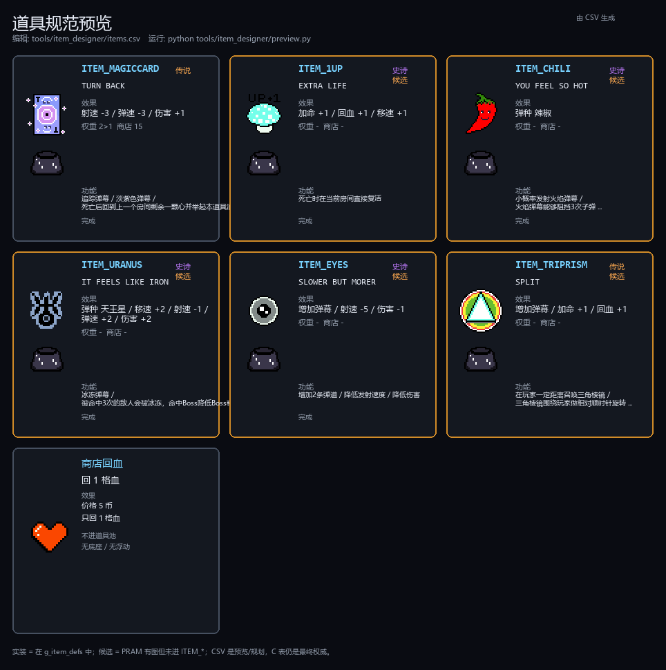

# 道具规范（可预览 / 可编辑）

> 版本：v1.0　日期：2026-10-23
> 预览图：
> 可编辑表：`tools/item_designer/items.csv`
> 生成器：`tools/item_designer/preview.py`
> 说明：CSV 和预览图是**规范/策划层**；C 里的 `g_item_defs` 仍是最终运行数据。改 CSV 不会自动改 C，用 `--emit-c` 生成片段后再贴回。

## 1. 文件清单

| 文件 | 作用 |
|---|---|
| `tools/item_designer/items.csv` | 唯一道具数据源（当前 5 件已实装 + 1 个候选；池子只刷 MagicCard） |
| `tools/item_designer/items.example.csv` | items.csv 缺失时读取的默认数据；不是硬编码 |
| `tools/item_designer/preview.py` | 读 CSV，生成预览图；`--emit-c` 打印 C 初始化片段 |
| `tools/item_designer/server.py` | 本地设计器后端：保存 CSV / 生成 PNG / 更新本表 / 生成实现请求 |
| `tools/item_designer/index.html` | 设计器前端（实时底图+图标预览） |
| `tools/item_designer/README.md` | 设计器启动与提交流程 |
| `tools/item_designer/design_brief.md` | 设计说明（首次保存时生成） |
| `tools/item_designer/pending_request.md` | 提交实现时生成（diff + C 片段 + 清单） |
| `docs/spec/道具预览.png` | 本规范用的预览图 |
| `docs/spec/道具_规范.md` | 本文件 |
| `code/logic/game/game_item.c` | `g_item_defs`、拾取、池子、绘制 |
| `code/logic/game/game_shop.c` | 商店 heart / 随机道具、固定价格 |
| `code/logic/game/game_vital.c` | 回血、加命 |
| `code/logic/game/game_state.c` | 道具房生成 / 单槽道具恢复 |
| `code/logic/game/game_boss.c` | Boss 击破掉饰品 |
| `code/logic/game/game_hud.c` | 拾取字幕（只认 A-Z / 空格） |

## 2. 道具在游戏里的流转

- **道具房**：本轮第一次进房时，从 `pool=1` 的道具里加权随机 1 个，放在房间中心；`game_room_mark_spawned()` 记住已生成。离开再回来，如果没拿，恢复同一个道具；拿过后本房间标记 used，不再生成。当前池子只有 MagicCard。
- **Boss 击破**：在 Boss 房中心掉 1 个随机饰品；`g.boss_drop_pending=1`。没捡就离开/重进 Boss 房，会恢复这个掉落；捡走后 `boss_drop_pending=0`。
- **商店**：每间商店固定 2 个商品——heart（5 币，回 1 格血）和 1 个随机道具（15 币）。商品首次进店决定，之后重进保持位置/类型/已买状态。
- **拾取**：用玩家“脚到眼睛”的身体矩形碰 32×32 道具；吃到后 `g.item.active=0`、结算 `game_item_apply()`、播 `get_acc` 姿势、顶部弹字幕、道具房标记 used。
- **单槽道具**：整个游戏只有一份 `g.item`（active/type/x/y），不是每间房各一份。换房时 `game_flow_enter_room()` 会先把它按房间类型重新激活/关闭；道具房/Boss 房按 pending/used 状态恢复。
- **右侧道具池**：按**拾取先后**从上往下排（`g.inv[]`），不显示数量；图标压暗（tone=3，强度 130）。最多显示 13 个。
- **字幕**：`game_hud_toast()` 用 16×24 大写字母，显示 2500 ms；结束后再擦 3 帧。只认 A-Z 和空格，其他字符会被跳过。

## 3. C 数据模型

### 3.1 item_def_t

```
typedef struct {
    const char *desc;   /* 顶部字幕，必须 A-Z / 空格 */
    int icon;           /* ASSET_... 素材编号 */
    item_mod_t mod;     /* 属性增减 */
} item_def_t;
```

### 3.2 item_mod_t 字段

| 字段 | 含义 | 当前结算 |
|---|---|---|
| `hp` | 回血点数 | 循环调用 `game_vital_heal_one()`，每次 +1，最多到 3 |
| `hp_max` | 血量上限增减 | **保留字段，代码暂不应用** |
| `lives` | 加命 | 循环 `game_vital_extra_life()`，最多 99 |
| `move_v8` | 移速增量（1/8 px/帧） | 加到 `stats.move_v8`，夹到 8..48；默认 24 |
| `fire_every` | 开火间隔增量（帧） | 加到 `stats.fire_every`，夹到 1..60；默认 14，越小越快 |
| `bullet_speed` | 玩家所有弹幕的速度增量 | 夹到 1..12；普通弹和多弹幕共用，默认 5 |
| `range` | 射程增量 | 夹到 1..99；默认 5；普通弹 1 点 = 32 px，追踪时 1 点 = 0.8 s |
| `damage` | 伤害增量 | 夹到 1..9；默认 1 |
| `bullet_type` | 弹种 | -1 = 不改；0/1/2 = `BULLET_A / BULLET_CHILI / BULLET_URANUS`；后拿的覆盖先拿的 |
| `triple` | 是否增加每次发射的弹幕数量 | 1 = 增加；当前实现为三向 3 发（`g.fire_triple`） |

**注意：**

- `triple=1` 现在**数据驱动**；当前 `ITEM_EYES` 就是靠自己的表项 `triple=1` 生效，不再按 item id 写死。
- `ITEM_EYES` 同时用 `bullet_speed=-2` 保持“SLOWER”手感；这个 **弹速对普通弹和多弹幕都生效**。
- `hp_max` 目前完全没用；不要在当前版本依赖它。
- `game_item_apply()` 直接按 `type` 取 `g_item_defs[type]`，不做 0..ITEM_COUNT-1 之外的保护；随机/商店/拾取来源保证合法。

### 3.3 道具编号 / 道具池

- `enum { ITEM_CHILI, ITEM_URANUS, ITEM_EYES, ITEM_1UP, ITEM_MAGICCARD, ITEM_COUNT };`（`game.h`）
- **编号 = `g_item_defs[]` 的下标 = `ITEM_*` 的顺序**；改顺序会让 `item_mask`、`g.inv[]`、存档/日志全部错位。
- `g.inv[INV_MAX]`：按拾取顺序保存每个实例的 `type / level / flags`；`g.inv_n` 是数量，支持从中间删除。
- `g.item_mask`：从 `g.inv[]` 派生的类型集合，只用于权重/快速判断。
- `game_item_random_type()`：只从 `pool=1` 里选，权重 = 没拿过 2 / 拿过 1 × 品质权重；当前只有 MagicCard `pool=1`。
- `item_index()`：查询 desc/icon 时用 `item % ITEM_COUNT`，避免越界；`game_item_apply()` 不用这个包装。

## 4. 当前道具

<!-- ITEM_TABLE_START -->
| ID | key | 字幕 desc | 图标 | 效果 | 品质 | 池 | 功能标签 | 状态 |
|---:|---|---|---|---|---|---|---|---|
| 0 | `ITEM_MAGICCARD` | TURN BACK | `ASSET_accessory_MagicCard_` / accessory_MagicCard!.png | 射速 -3 / 弹速 -3 / 伤害 +1 | 传说 | 入池 | 追踪弹幕 / 淡紫色弹幕 / 死亡后回到上一个房间剩余一颗心并举起本道具消耗，仅一次 | 已实装 |
| — | `SHOP_HEART` | — | `ASSET_SpecialEffect_heart` / SpecialEffect_heart.png | 回 1 格血 / 5 币 / 不进道具池 | — | — | — | 已实装 |
| 1 | `ITEM_1UP` | EXTRA LIFE | `ASSET_accessory_1UP_ExtraLiFE` / accessory_1UP!ExtraLiFE.png | 回血 +1 / 命数 +1 / 移速 +1 | 史诗 | 入池 | 死亡时在当前房间直接复活 | 候选（未进 ITEM_COUNT） |
| 2 | `ITEM_CHILI` | YOU FEEL SO HOT | `ASSET_accessory_chili` / accessory_chili.png | 弹种 CHILI | 史诗 | 入池 | 小概率发射火焰弹幕 / 火焰弹幕能够阻挡3次子弹 / 火焰弹幕能够存活2s / 火焰弹幕伤害=玩家伤害+道具面板伤害 / 火焰弹幕以更低的tick造成伤害 | 候选（未进 ITEM_COUNT） |
| 3 | `ITEM_URANUS` | IT FEELS LIKE IRON | `ASSET_accessory_Uranus` / accessory_Uranus.png | 弹种 URANUS / 移速 +2 / 射速 -1 / 弹速 +2 / 伤害 +2 | 史诗 | 入池 | 冰冻弹幕 / 被命中3次的敌人会被冰冻，命中Boss降低Boss移速 / 被命中的所有敌人接下来发射的弹幕弹速下降 / Boss的弹幕弹速下降每5s触发一次 / 被命中的所有敌人在弹幕弹速下降时覆盖一层蓝色滤镜 | 候选（未进 ITEM_COUNT） |
| 4 | `ITEM_EYES` | SLOWER BUT MORER | `ASSET_accessory_Inner_eyes` / accessory_Inner_eyes.png | 增加弹幕 / 射速 -5 / 伤害 -1 | 史诗 | 入池 | 增加2条弹道 / 降低发射速度 / 降低伤害 | 候选（未进 ITEM_COUNT） |
| 5 | `ITEM_TRIPRISM` | SPLIT | `ASSET_accessory_TriPrism` / accessory_TriPrism.png | 增加弹幕 / 回血 +1 / 命数 +1 | 传说 | 入池 | 在玩家一定距离召唤三角棱镜 / 三角棱镜围绕玩家做相对顺时针旋转 / 所有玩家弹幕命中三角棱镜后沿弹幕移动方向分裂为4份彩色弹幕 / 分裂的4份弹幕分别为加上红/黄/绿/蓝滤镜 / 分裂的4份彩色弹幕按照一定角度散射移动方向 | 候选（未进 ITEM_COUNT） |
<!-- ITEM_TABLE_END -->

> 候选道具只存在于 PRAM/预览；`ITEM_COUNT` 现在是 5（MagicCard 已加入），`TriPrism` 仍未进 C。未入池的道具不会在道具房/Boss/商店出现。
>
> **当前**：`ITEM_1UP` 已实装但 `pool=0`（旧 `lives+1` 仍是临时占位）；`MagicCard` `pool=1`；`TriPrism` `pool=0`。
>
> **本表由本地设计器保存时自动更新**：`python tools/item_designer/server.py` → http://127.0.0.1:8765。保存会同时写 `tools/item_designer/items.csv`、本表和 `道具预览.png`。

### 4.1 魔法卡 / TURN BACK（已实装）

- **T = track**；`TURN BACK` 是死亡词条，不是卡名。
- **触发**：HP 归零的死亡判定处，扫描道具池里的 **`LIFE_PLUS`** 属性，按拾取顺序**先扫到谁用谁**。
- **效果**：不扣命；消耗触发道具并撤销它的属性增减；回到 `last_room`；位置是该房间通往死亡房间那扇门的入口；HP = **1 格**；给短暂无敌。
- **动画**：触发时从 `g.inv` 移除，但 `g.held_type` 保留图标做 `get_acc` 举手；`pickup_until` 延长到无敌结束之后，保证能看见。
- **房间结算**：地形破坏、商店购买、道具拿取保留；死亡房间怪物刷新。
- **回退渲染**：强制整屏重铺（`game_room_request_full`），清掉死亡房间怪/Boss 留在缓冲里的旧贴图。
- **`last_room` 不存在**：回**起始房间中心**。
- **Boss**：Boss 房死亡与普通房走同一套；**如果 Boss 已死亡，则不重置房间**，但仍走 TURN BACK 流程。
- **道具池**：当前只有 MagicCard `pool=1`；其它道具全部 `pool=0`，不会随机/进商店。
- **本次已接**：`level / pool / life_plus`、`g.inv[]`、`last_room/last_door`、死亡回退、HP 1、举手、消耗、死亡房间刷怪。
- **弹幕特性**：生成时锁定最近的小怪/Boss；飞行中只向该目标做 1/4 弧线插值，目标在身后或距离很近时不再拐弯，避免过冲后掉头；射程改按存活时间算，1 点 = 0.8 s，射程 = 弹速 × 时间；所有玩家弹幕叠加更深的紫色 tint（0xA050D0，浓度 160）。
- **MagicCard 射程**：range=-1；基础 5 → 4，即追踪存活 3.2 s。
- **普通弹**：射程 = range × 32 px。
- **道具消失/消耗**：从 `g.inv[]` 移除后按剩余背包整体重算 `move / fire / bullet_speed / range / damage / bullet_type / triple`；`hp / lives` 是拾取时一次性收益，不回收。

## 5. 图标 / 底座素材规范

- **底座**：共享 `accessory_base.png`，32×32 RGBA；所有道具都用它。
- **图标**：`res/pic/accessory/accessory_<Name>.png`，**32×32 RGBA**。透明背景；α 尽量只用 0/255（半透明会拆调色板索引，容易糊）。
- **ck 约定**：透明像素落成纯白（调色板索引 0，α=0）；不透明区不能有纯白，否则会被 ck 抠掉。
- **命名到 C**：生成器会把非字母数字转下划线，例如 `accessory_1UP!ExtraLiFE.png` → `ASSET_accessory_1UP_ExtraLiFE`，`accessory_MagicCard!.png` → `ASSET_accessory_MagicCard_`。C 永远用 `ASSET_...` 名字，不写数字。
- **进 PRAM**：把 PNG 放进 `res/pic/accessory/`（不要放 `_原始图`），运行：

    uv run tools/img2hex/pic2pram.py

  然后看 `tools/img2hex/output/report.txt`：PRAM 总量、调色板、纯白警告。当前上限 32768 字；本次 93 项占 25728 字（100.50 KiB，78.52%）。
- **顺序**：打包器按目录 + 文件名排序编号；新增一张图会让它后面的素材编号平移。C 用名字所以不用改代码，但**固件必须重新编译**。
- **绘制位置**（`game_item.c`）：
  - 底座画在 `(item.x, item.y)`，32×32；
  - 图标画在 `(item.x, item.y + ITEM_ICON_DY + float_y)`；`ITEM_ICON_DY=-33`，`ITEM_FLOAT_AMP=5`，即图标底边贴着底座顶边上下浮动 5 px；
  - 拾取判定/商店按 32×32（`ITEM_W/ITEM_H`、`SHOP_ITEM_W/H`）；图标也请保持 32×32，否则可见范围/判定会不一致。
- **预览 vs 硬件**：预览图直接用源 PNG；板上是 8bpp 共用调色板量化后的颜色。渐变/半透明多的图会有色差，先看 report 再上板。

## 6. 可编辑表 items.csv

### 6.1 列

| 列 | 说明 |
|---|---|
| `id` | 道具编号；已启用行必须从 0 连续，且与 `ITEM_*` 顺序一致 |
| `key` | C 枚举名，如 `ITEM_CHILI`；用于预览标签和 emit 注释 |
| `enabled` | 1 = 设计启用（参与 emit / 正常卡；是否已进 C 看 `game.h` / `game_item.c`，表里会标“待实现”）；0 = 候选（橙色“候选”标签，不参与 emit） |
| `desc` | 顶部字幕；**只能 A-Z 和空格**（当前字模限制） |
| `icon_asset` | `assets_desc.h` 里的 `ASSET_...` 名字；脚本会校验 |
| `icon_file` | 预览用源 PNG 文件名（在 `res/pic/accessory/`） |
| `bullet` | `-` / `CHILI` / `URANUS`；对应 `-1` / `BULLET_CHILI` / `BULLET_URANUS` |
| `triple` | 1 = 增加每次发射的弹幕数量（当前实现为三向 3 发）；现在数据驱动 |
| `hp` | 回血点数；0 = 不回 |
| `lives` | 加命数；0 = 不加 |
| `move_v8` / `fire_every` / `bullet_speed` / `range` / `damage` | 有符号增量，0 = 不改；弹速对普通/多弹幕都生效；射程普通按 32 px/点，追踪按 0.8 s/点；夹取范围见 3.2 |
| `note` | 预览卡底部备注，纯展示 |
| `features` | JSON 数组；每项一条**功能标签**（如“命中吸血 15%”“800ms CD”）。页面用 + / × 增删；属性的加减仍用上面的数值字段，不混在这里 |
| `level` | 品质 0..3：普通 / 稀有 / 史诗 / 传说。**固定**在道具定义上，不重抽、不改同一件道具的品质；只影响它在道具池里的出现权重 |
| `pool` | 1 = 进入道具池（道具房/Boss/商店随机）；0 = 只在设计器/规范里，不参与随机、不进商店 |
| `life_plus` | 1 = 生命保险：死亡判定时按拾取顺序找第一个，消耗并回上一房间；0 = 无 |

**品质权重（level 固定）：**

| level | 名称 | 权重 |
|---:|---|---:|
| 0 | 普通 | 100 |
| 1 | 稀有 | 45 |
| 2 | 史诗 | 15 |
| 3 | 传说 | 4 |

**不在 CSV 里的全局规则（当前代码写死）：**

- 道具房/商店随机权重：没拿过 2，拿过 1；再乘上面的品质权重。
- 商店道具价格：任意道具 15 币；heart 5 币。
- 右侧池子：按拾取顺序，每个 40 px；当前 4 件占 y=168..约 334。屏幕高度大约能放 14 个，再多需要改布局。
- 底座/浮动/池子压暗：全局统一，不是每件道具独立字段。

### 6.2 预览 / 生成

    python tools/item_designer/preview.py
    python tools/item_designer/preview.py --emit-c

- 默认输出 `docs/spec/道具预览.png`；本仓库里已经生成了一份。
- 如果提示没有 Pillow：`python -m pip install pillow`，或 `uv run --with pillow python tools/item_designer/preview.py`。
- `--emit-c` 只打印，不写 C；把输出贴进 `game_item.c`，并同步 `game.h` 的 `ITEM_*` / `ITEM_COUNT`。
- 脚本会校验：`icon_asset` 是否在 `assets_desc.h`、`icon_file` 是否存在、已启用行的 desc 是否只有 A-Z/空格；有问题会打 `[WARN]`。
- **推荐用本地设计器**：`python tools/item_designer/server.py` → `http://127.0.0.1:8765`；保存会自动写 CSV、规范表和 `道具预览.png`，提交会生成 `pending_request.md`。
- **特殊功能怎么写**：见 [第 11 节](#11-特殊功能描述模板)（触发/效果/数值/叠加/边界/验收模板 + 3 个完整例子）。

## 7. 新增一件道具（步骤）

1. **画图标**：32×32 RGBA，透明底，尽量纯硬边；命名 `accessory_<Name>.png`，放进 `res/pic/accessory/`。
2. **打包 PRAM**：运行 `uv run tools/img2hex/pic2pram.py`；打开 `tools/img2hex/output/report.txt` 确认不超预算、没有“不透明纯白”；在 `assets_desc.h` 找到新的 `ASSET_accessory_<Name>`。
3. **编辑 CSV**：在 `items.csv` 末尾加一行，`id` 接在已启用行后面，`enabled=1`，填 `key/desc/icon_asset/icon_file` 和效果字段；运行脚本看预览。
4. **改 C 枚举**：在 `game.h` 的 `enum { ITEM_..., ITEM_COUNT }` 里加新名字（建议加在 1UP 后、ITEM_COUNT 前），`ITEM_COUNT` 自动 +1。
5. **改 C 表**：把 `--emit-c` 的输出贴进 `game_item.c` 的 `g_item_defs`；确保下标与枚举顺序一致。
6. **决定掉落/商店**：新道具会自动进入 `game_item_random_type()` 的随机池（道具房/Boss/商店都会出）。如果你不想让它随机出，需要改 `game_item.c` 的权重/随机函数。
7. **池子布局**：池子按 `ITEM_COUNT` 向下排；大约 14 个以后会超出 720 屏幕，需要改 `game_item_draw_pool()`（两列/缩小图标/分页）。
8. **重编固件 + 重综合**：PRAM 和 `assets_desc.h` 都变了；先 `make clean`（makefile 不跟踪头文件依赖），再编译固件；比特流也要重新生成，两者一起烧。

## 8. 当前限制 / 注意

- `ITEM_COUNT=4`（当前 4 件）；右侧池子按 `ITEM_COUNT` 向下排（y 起点 168，步进 40），屏幕高度约 14 个，不是硬编码 4 槽。
- `triple=1` 现在数据驱动（当前实现为三向 3 发）；`hp_max` 未接；商店价格/权重是全局固定值。
- 字幕字模只有 A-Z 和空格；desc 不要写中文/数字/标点，否则会被跳过（但位置仍前进）。
- `item_mask` 是 32 位；理论上可到 32 件，但 UI/数组/布局按 4 件设计。
- 道具图标请保持 32×32；底座共享；半透明 α 会拆调色板索引，尽量只用 0/255。
- 新增素材会让后续素材编号平移；C 用名字，但**固件必须重编**，不能只换 PRAM/bitstream。
- 预览图是源图，不是板上 8bpp 调色板结果；最终以 report + 上板为准。

## 9. 预览


## 10. 变更记录

| 日期 | 变更 |
|---|---|
| 2026-10-23 | 首版：4 件已实装 + 2 个候选（MagicCard / TriPrism）+ 商店 heart；CSV 可编辑、脚本可预览/emit C；明确增加弹幕/hp_max/价格/池子等限制 |
| 2026-10-23 | 移除独立 `triple_speed`；`bullet_speed` 统一作用于普通/多弹幕；`triple` 改为“增加每次发射的弹幕数量”并数据驱动；EYES 用 `bullet_speed=-2` 保持 SLOWER；道具 spec 合并为单 MD + 单 PNG |

## 11. 特殊功能描述模板

> 特殊功能描述模板已并入本节；道具相关只保留本文件和 `道具预览.png`。

> 用途：在本地设计器的“本次设计说明”里写特殊机制。保存/提交后会进 `tools/item_designer/pending_request.md`，AI 按它实现。
>
> 简单道具（只改数值、弹种、加命、增加弹幕）不用长文，直接填 CSV 字段即可；**特殊功能**才需要下面这套。

### 11.1 一句话原则

写“**可执行的行为**”，不要写“感觉 / 风格 / 像某游戏”。

AI 需要知道：

1. **什么时候触发**（拾取 / 每帧 / 每 N 帧 / 命中 / 开火 / 受伤 / 进房 / 低血）
2. **对谁**（玩家 / 最近敌人 / 全体敌人 / 子弹 / 金币 / 房间）
3. **发生什么**（伤害 / 回血 / 生成弹 / 护盾 / 减速 / 吸币 / 传送）
4. **数值和单位**（px / 帧 / ms / % / 层数）
5. **重复拿怎么叠**（叠加 / 刷新 / 取最高 / 不叠 / 上限）
6. **边界**（Boss / 无敌 / 死亡 / 换房 / 满血 / 性能上限）
7. **怎么验收**（观察什么，预期结果）

### 11.2 先判断：能不能直接用 CSV 字段

| 想做的效果 | 能不能只填 CSV |
|---|---|
| +回血、+加命、换弹种、增加弹幕、移速/射速/弹速/伤害增减 | **能**，填对应字段 |
| 命中吸血、命中爆炸、弹射、穿透、回旋镖 | **不能**，要写说明 + C 逻辑 |
| 环绕物、召唤物、光环、护盾、主动技能 | **不能**，要写说明 + C 逻辑 |
| 金币磁铁、掉落变化、商店折扣 | **不能**，要写说明 + C 逻辑 |
| 条件触发（低血、满血、连续命中、击杀） | **不能**，要写说明 + C 逻辑 |

> CSV 里的 `note` 是每张卡的短备注；**长机制说明写在上面的“本次设计说明”里**，一段一个道具。

### 11.3 模板（复制到“本次设计说明”）

页面顶部有“插入特殊功能模板”按钮，点一下会自动填入下面的结构；也可以手动复制：

    ## 道具：<名字>（key: ITEM_XXX）
    - 类型：被动 / 触发 / 主动 / 召唤 / 经济
    - 图标：accessory_xxx.png（32×32；没有就先用现有图占位）
    - 触发：什么时候发生（拾取 / 每帧 / 每 N 帧 / 命中 / 开火 / 受伤 / 进房 / 低血）
    - 效果：发生什么（伤害 / 回血 / 生成弹 / 护盾 / 减速 / 吸币 / 传送）
    - 数值：数值 + 单位（px / 帧 / ms / % / 层数）
    - 叠加：重复拾取 / 多件同类 / 与 EYES 增加弹幕怎么叠
    - 视觉：图标 / 颜色 / 闪烁 / HUD 提示（HUD 只认 A-Z 和空格）
    - 边界：Boss / 无敌 / 死亡 / 换房 / 满血 / 性能上限
    - 验收：怎么观察、预期结果

写的时候注意：

- **单位写死**：不要写“快一点”，写“每 800 ms 最多触发 1 次”。
- **概率写清分母**：不要写“有概率”，写“每次命中独立 15%”；多颗子弹同帧是否分别判定。
- **叠加写清上限**：不要写“可叠加”，写“每层 +5%，最多 3 层 / 35%”。
- **边界写清禁止**：不要写“正常情况”，写“Boss 也生效；环境伤害不触发；满血时不回血但不进冷却”。
- **验收可观察**：不要写“手感好”，写“对同一只 slime 打 100 发，回血 10–20 次”。

### 11.4 三个完整例子

#### 例 1：吸血牙（命中触发）

    ## 道具：吸血牙（key: ITEM_VAMP）
    - 类型：被动触发
    - 图标：accessory_TriPrism.png（先用现有图占位）
    - 触发：玩家子弹命中敌人时，每颗子弹独立判定
    - 效果：15% 概率回 1 格血；回血上限 3
    - 数值：概率 15%；内置冷却 800 ms；冷却期间不再触发
    - 叠加：重复拾取每层 +5% 概率，最多 3 层 / 35%；冷却不缩短
    - 视觉：回血时玩家闪红 120 ms；不新增 HUD 文字
    - 边界：Boss 也生效；环境伤害不触发；满血时不回血，但也不进冷却
    - 验收：对同一只 slime 连续射击 100 发，回血约 10–20 次；800 ms 内连续命中最多回 1 次；3 层时约 25%

#### 例 2：环绕棱镜（持续召唤）

    ## 道具：环绕棱镜（key: ITEM_ORBIT）
    - 类型：持续召唤
    - 图标：accessory_TriPrism.png
    - 触发：拾取后常驻，每帧更新
    - 效果：1 个棱镜绕玩家半径 40 px 顺时针转，碰到敌人造成 1 伤害
    - 数值：半径 40 px；角速度 180°/s（2 秒一圈）；伤害 1；同一敌人 500 ms 内置 CD；棱镜不挡子弹
    - 叠加：每多 1 件 +1 个，最多 3 个，均匀分布；伤害不叠
    - 视觉：用现有棱镜图；不闪烁；右侧池子显示图标
    - 边界：换房保留；死亡清除；Boss 也生效；不与其他环绕物叠加
    - 验收：站到 slime 旁边 2 秒，slime 掉约 4 血；2 件时两个棱镜对称；3 件时 120° 分布

#### 例 3：磁铁（经济/移动）

    ## 道具：磁铁（key: ITEM_MAGNET）
    - 类型：被动持续
    - 图标：accessory_TriPrism.png
    - 触发：每帧对场上金币
    - 效果：96 px 内金币以 3 px/帧向玩家移动；不影响心/道具
    - 数值：半径 96 px；速度 3 px/帧；叠加每层 +32 px，最多 160 px
    - 叠加：重复拾取 +32 px，上限 160；不加速
    - 视觉：金币移动；无 HUD
    - 边界：只吸普通金币，不吸商店价格；换房保留；金币出屏后不追
    - 验收：在 100 px 放 1 枚金币，2 秒内吸到；170 px 不动；2 层时 128 px 内的金币会动

### 11.5 坏例子 vs 好例子

| 坏例子 | 为什么坏 | 改成 |
|---|---|---|
| “吸血道具，打怪回血，很稀有” | 没触发条件、没数值、没叠加 | 例 1 |
| “像以撒的妈刀” | 只有参考，没有行为 | “飞出去 24 帧后返回，去程/回程各 1 伤害，同一敌人 300 ms CD” |
| “每 3 发子弹变 3 发” | 是“每 3 发”还是“每发 3 发”？ | “每第 3 次开火改成 3 发扇形，其余开火不变” |
| “一个很酷的护盾” | 没层数、没持续时间、没边界 | “每 6 秒 +1 层，最多 2 层；每层挡 1 次伤害；受伤后 1 秒无敌” |
| “让游戏更爽” | 不可验收 | “移速 +8（1/8 px/帧），射速 -2 帧，持续到本轮结束” |

### 11.6 当前引擎的约束（写之前先看）

- **道具数值表只覆盖现有字段**：`hp / hp_max / lives / move_v8 / fire_every / bullet_speed / damage / bullet_type / triple`。特殊逻辑要改 C。
- `hp_max` **还没应用**；`triple=1` 现在数据驱动（当前实现为三向 3 发）。
- 商店价格固定：道具 15 币、heart 5 币；随机权重固定：没拿过 2、拿过 1。要改要写清。
- 道具池 `ITEM_COUNT` 当前 4；新道具要加 C 枚举/表；右侧池子按 `ITEM_COUNT` 向下排，屏幕大约 14 个。
- 图标 **32×32 RGBA**；PRAM 预算 32768 字（当前 93 项 / 25728 字）；新图标先放 `res/pic/accessory/` 并跑 `uv run tools/img2hex/pic2pram.py`。
- HUD 字模只认 **A-Z 和空格**；不要写中文/数字字幕。
- 默认按**无音效**设计；不要依赖音效反馈。
- **没有存档**：重开一局全部重置；换房是否保留要写清。
- **实体/性能**：环绕物、召唤物、每帧特效要写上限；不要在每帧里创建大量对象。
- **拾取应用** `game_item_apply()` 是瞬间结算；持续/触发/主动需要新增每帧/命中/输入钩子。
- **描述里不要写“改 RTL / 改硬件”**；道具逻辑在 C 层。

### 11.7 提交前检查清单

- [ ] key、图标、CSV 字段已填；简单效果没有重复写代码。
- [ ] 触发条件明确（什么时候、对谁、每帧/每次命中/每 N 帧）。
- [ ] 数值 + 单位明确（px / 帧 / ms / % / 层数）。
- [ ] 叠加规则明确（重复拾取、多件同类、与 EYES/弹种的关系）。
- [ ] 边界明确（Boss、无敌、死亡、换房、满血、性能上限）。
- [ ] 验收步骤可观察、可重复。
- [ ] 需要新图标/新 C 字段/新 HUD 的地方写出来了。

### 11.8 在设计器里写在哪

1. **每张卡的 note**：一句话短备注，会进 CSV 和请求的“每项 note”。
2. **每张卡下方“功能标签”**：点 + 添加一条，点 × 删除；适合放短标签（“命中吸血”“800ms CD”“对 Boss 生效”）。详细的触发/数值仍写“本次设计说明”。
3. **顶部“本次设计说明”**：复制 11.3 的模板，一段一个特殊道具；这是 AI 实现的主要依据。
4. 保存后：CSV、规范表、`道具预览.png` 自动更新。
5. 提交后：`tools/item_designer/design_brief.md` + `tools/item_designer/pending_request.md` 生成；回到对话发“请读取 tools/item_designer/pending_request.md 并实现道具”。

> 说明：设计器生成的 C 片段只覆盖现有 `item_mod_t` 字段；特殊机制由 AI 在 C 里补，所以**说明写得越像伪代码，实现越准**。
